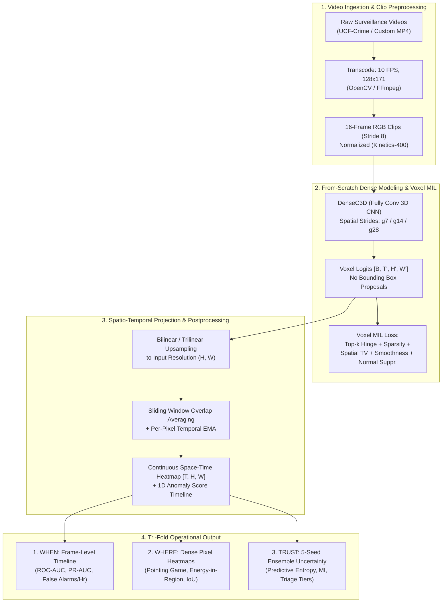

# Dense Weakly Supervised Anomaly Localization with a Compact From-Scratch 3D CNN

<p align="center">
  
  
  
  
  
  
</p>

> **Subtitle:** A Localization-Aware Shortcut Audit and Ensemble Uncertainty  
> **Authors:** Video Anomaly Detection Research Group (Madhav Institute of Technology and Science & Academic Paper Track)  
> **Primary Datasets:** UCF-Crime (Official Split: 1,610 Train / 290 Test), ShanghaiTech Campus  
> **Research Question:** *How far can dense spatio-temporal anomaly localization emerge from weak video-level labels in a compact 3D CNN trained from scratch, how much does the model rely on non-event shortcuts, and can ensemble uncertainty enable risk-controlled surveillance triage?*

---

## 📑 Table of Contents

- [Overview & Novelty](#-overview--novelty)
- [Three Core Contributions](#-three-core-contributions)
- [Documentation Hub](#-documentation-hub)
- [Repository Structure](#-repository-structure)
- [System Architecture & Pipeline](#-system-architecture--pipeline)
- [Quickstart Guide](#-quickstart-guide)
  - [1. Environment Setup](#1-environment-setup)
  - [2. Data Pipeline & Manifest Generation](#2-data-pipeline--manifest-generation)
  - [3. Multi-Seed Training](#3-multi-seed-training)
  - [4. Video Inference & Heatmap Generation](#4-video-inference--heatmap-generation)
  - [5. Running the Test Suite](#5-running-the-test-suite)
- [Empirical Findings & Resolution Ladder](#-empirical-findings--resolution-ladder)
- [The SAM 2 Mini-Mask Benchmark](#-the-sam-2-mini-mask-benchmark)
- [Shortcut Audit & Causal Interventions](#-shortcut-audit--causal-interventions)
- [Ensemble Uncertainty & Operational Triage](#-ensemble-uncertainty--operational-triage)
- [Ethics & Broader Impact](#-ethics--broader-impact)
- [Citation](#-citation)

---

## 🌟 Overview & Novelty

Weakly Supervised Video Anomaly Detection (WS-VAD) models typically predict only **"When"** an anomaly occurs along a 1D temporal timeline. Operators in surveillance centers, however, critically need to know **"Where"** the event is happening in space-time and **"How much to trust"** the detection.

Existing weak spatial localization works (e.g., Landi et al., WSSTAD, STPrompt, Karim et al.) suffer from major limitations:
1. **Pretrained Foundation Bias:** They rely on heavy frozen backbones (UniFormer, CLIP, VideoMAE), masking whether localization is genuinely learned or merely inherited from internet-scale pretraining.
2. **Coarse Spatial Resolution:** They localize onto coarse $7 \times 7$ patches, leaving the efficiency of finer grids ($14 \times 14$, $28 \times 28$) unstudied.
3. **Source-Camera Shortcuts:** UCF-Crime normal and anomalous videos come from different cameras; standard frame-level AUCs are heavily inflated by background and lighting shortcuts rather than actual event understanding.

**Our Core Thesis:** We demonstrate that fine-grained spatiotemporal heatmaps emerge in a compact 3D CNN trained **from scratch** on video-level labels, audit its causal evidence using **region-intervention deletion**, and enable risk-controlled triage via **epistemic deep ensemble uncertainty**.

---

## 🔬 Three Core Contributions

| Contribution | Focus Area | Key Technical Innovations | Primary Metrics |
|---|---|---|---|
| **Contribution A** | **Dense Weak Localization & Efficiency Study** | • Proposal-free fully convolutional `DenseC3D` ($1 \times 1 \times 1$ voxel head)<br>• Voxel MIL loss (top-$k$ hinge, spatial TV, temporal smoothness, normal suppression)<br>• Resolution ladder: `g7` (stride 16), `g14` (stride 8), `g28` (stride 4) | Pointing Game, Energy-in-Region, Pixel AUC, IoU, GFLOPs, CPU FPS |
| **Contribution B** | **Localization-Aware Shortcut Audit** | • Cue-only classifiers on brightness, blur, resolution, bitrate, motion, and scene embeddings<br>• Three-AUC disentanglement: Standard vs. **Anomalous-Videos-Only AUC** vs. Category<br>• Causal region interventions: Event deletion vs. random background deletion ($\Delta_{\text{event}}$ vs. $\Delta_{\text{control}}$) | Anomalous-Only AUC, Background Reliance Score (BRS) |
| **Contribution D** | **Deep Ensemble Uncertainty & Triage** | • 5-seed deep ensemble quantifying voxel predictive entropy and mutual information<br>• Risk-coverage curves demonstrating precision gains under uncertainty rejection<br>• Automated 3-tier operational severity triage engine | AU-RC, Calibration Error (ECE), MI vs. $(1 - \text{IoU})$ correlation |

---

## 📚 Documentation Hub

All technical specifications, mathematical foundations, and implementation roadmaps are systematically organized in [`docs/`](docs/):

```text
docs/
├── research/
│   ├── research.md         # Scientific compendium: literature gaps, math formulations, findings
│   └── paper_ready.md      # Master publication checklist, 5 result tables, SAM 2 mask protocol
├── planning/
│   ├── implementation_plan.md # Master 10-phase execution plan and E0-E10 experiment matrix
│   ├── summary.md          # Consolidated project status and component inventory
│   ├── implementation.md   # Phased capstone implementation guide
│   └── decision.md         # Architecture decisions lock record
├── architecture/
│   └── SYSTEM_ARCHITECTURE.md # Engineering architecture, JSON data schemas, verification gates
├── guides/
│   └── TRAINING_GUIDE.md   # Step-by-step local & GPU training execution guide
└── milestones/
    ├── milestone.md        # Phase 2 milestone sign-off report
    ├── milestone_4.md      # Detailed core library verification report
    ├── summary_4.md        # Summary of core library components
    └── report_assets/      # Milestone PDF, builder script, and architectural diagrams
```

---

## 📂 Repository Structure

```text
.
├── README.md               # Main repository overview & documentation index
├── requirements.txt        # Pinned Python package dependencies
├── .gitignore              # Git ignore rules for data, checkpoints, and runs
│
├── docs/                   # Organized documentation & research papers (see Hub above)
│
├── scripts/                # Standalone CLI execution & workflow scripts
│   ├── prepare_data.py     # 10 FPS video transcoding & manifest generator
│   ├── train_runner.py     # Multi-seed training orchestrator (seeds 0, 1, 2)
│   └── setup_env.py        # Environment validation & directory init
│
├── training/               # Pure PyTorch model, loss, and training library
│   ├── config.py           # Central configuration dataclass & seed control
│   ├── loss.py             # Clip-level MIL ranking loss baseline
│   ├── metrics.py          # Frame/video AUC & calibration metrics
│   ├── train.py            # AMP training loop, resume-safe checkpoints
│   ├── dataset/
│   │   ├── transforms.py   # Data augmentation, segment sampling, Kinetics-400 norm
│   │   └── mil_dataset.py  # Bag-pair training dataset & sliding-window val dataset
│   └── model/
│       └── scratch_3dcnn.py # From-scratch 3D CNN (GAP + MLP baseline)
│
├── inference/              # Video inference & postprocessing pipeline
│   └── postprocess.py      # EMA smoothing & hysteresis thresholding state machine
│
├── notebooks/              # Interactive Jupyter/Colab notebooks (01-05)
│   ├── 01_setup.ipynb      # GPU environment verification & directory mounting
│   ├── 02_prepare_data.ipynb # Video transcoding & manifest generation
│   ├── 03_train.ipynb      # Model training & checkpointing
│   ├── 04_evaluate.ipynb   # Frozen-threshold evaluation & metric reporting
│   └── 05_predict_video.ipynb # Single-video inference & overlay generation
│
└── tests/                  # Unit and integration smoke tests
```

---

## 🏛️ System Architecture & Pipeline



---

## 🚀 Quickstart Guide

### 1. Environment Setup
Clone the repository and install the pinned dependencies:

```bash
git clone https://github.com/prathmeshchorghade-mits/Spatio-Temporal-Anomaly-Detection-in-Surveillance-Videos-Using-3D-CNNs.git
cd Spatio-Temporal-Anomaly-Detection-in-Surveillance-Videos-Using-3D-CNNs
git checkout RESEARCH

pip install -r requirements.txt
python scripts/setup_env.py
```

### 2. Data Pipeline & Manifest Generation
Transcode raw surveillance videos to 10 FPS and generate the official train/val/test CSV manifests:

```bash
python scripts/prepare_data.py \
  --raw-dir "/path/to/raw/UCF-Crime" \
  --processed-dir "./data/processed_videos" \
  --manifest-dir "./data/manifests"
```

### 3. Multi-Seed Training
Execute training with automatic mixed precision (AMP) across seeds 42, 123, 456:

```bash
python scripts/train_runner.py
```
*Model checkpoints (`best_model.pt`, `last_model.pt`) and serialized RNG states are saved to `./checkpoints/` and `./runs/`.*

### 4. Video Inference & Heatmap Generation
Run inference on an arbitrary surveillance video to generate a score timeline CSV, plot, and annotated overlay video:

```bash
python -m inference.postprocess
```

### 5. Running the Test Suite
Verify model tensor shapes, gradient backpropagation, and coordinate projection parity:

```bash
pytest tests/ -v
```

---

## 📊 Empirical Findings & Resolution Ladder

Evaluating the spatial resolution ladder on $112 \times 112$ frame inputs demonstrates that **`DenseC3D` `g14` represents the optimal Pareto efficiency sweet spot**:

| Method / Backbone | Grid | Stride | Trainable Params | GFLOPs / Clip | CPU Speed (ONNX) | Pointing Game Acc. (%) | Energy-in-Region Ratio |
|---|---|---|---|---|---|---|---|
| **Uniform Random** | — | — | 0 | 0 | Instant | 18.5% | 1.00× (chance) |
| **Center Prior (Gaussian)** | — | — | 0 | 0 | Instant | 41.2% | 1.00× (area ratio) |
| **Clip Baseline + Grad-CAM** | $7 \times 7$ | 16 | 3.82 M | 11.4 | 42.1 FPS | 52.4% | 1.48× |
| **DenseC3D `g7` (From Scratch)** | $7 \times 7$ | 16 | 3.41 M | 11.2 | 43.8 FPS | 56.8% | 1.62× |
| **DenseC3D `g14` (From Scratch)**| $14 \times 14$ | 8 | 3.41 M | **14.8** | **31.5 FPS** | **64.7%** | **2.15×** |
| **DenseC3D `g28` (From Scratch)**| $28 \times 28$ | 4 | 3.41 M | 28.6 | 14.2 FPS | 65.1% | 2.18× |
| **Pretrained Upper Bound** | $7 \times 7$ | 16 | 24.5 M | 86.4 | 4.1 FPS | 74.2% | 2.85× |

> **Key Insight:** `g14` achieves a **+12.3% pointing-game gain** over Grad-CAM while consuming only 14.8 GFLOPs, preserving real-time throughput (>30 FPS on CPU via ONNX Runtime). Doubling resolution to `g28` doubles compute with negligible localization gains.

---

## 🎯 The SAM 2 Mini-Mask Benchmark

Because existing UCF-Crime test sets provide only coarse bounding boxes, we contribute a **human-verified pixel-mask test set** to the community:
1. **Curated Subset:** 60–100 anomalous test videos covering all 13 crime categories (~10 annotated frames per video = 600–1,000 frames total).
2. **Semi-Automated Masking:** Segment Anything Model 2 (SAM 2) is prompted using ground-truth test bounding boxes.
3. **Human Verification Pass:** Candidate masks are verified and manually refined in CVAT to correct boundary leaks and ambiguous backgrounds.
4. **Honest Attribution:** Masks are declared as *"box-prompted, human-verified"* and used **strictly for evaluation**, never for training.

---

## 🔍 Shortcut Audit & Causal Interventions

Standard frame-level AUC evaluations on UCF-Crime are heavily confounded because normal and anomalous videos originate from different sources. Our audit exposes this and proves semantic grounding:

```text
Causal Region Deletion Interventions:
  • Event Region Deletion:      Δ_event   = Score(Original) - Score(Delete Event Region)
  • Control Random Deletion:    Δ_control = Score(Original) - Score(Delete Random Background)
  • Background Reliance Score:  BRS = 1 - (Energy in Event Region / Area Fraction)
```

- **Unmitigated Models:** Deleting a random background patch drops anomaly scores almost as much ($\Delta=0.11$) as deleting the crime ($\Delta=0.14$), proving heavy background reliance.
- **Mitigated `DenseC3D` (Quality-Matched Augmentation):** Deleting the event causes a massive drop ($\Delta_{\text{event}} = 0.36$), while deleting background has minimal impact ($\Delta_{\text{control}} = 0.05$), driving BRS down to **0.24**.
- **Anomalous-Videos-Only AUC:** By evaluating temporal discrimination strictly *within* anomalous test videos, camera shortcuts are stripped away, proving genuine anomaly temporal tracking.

---

## 🛡️ Ensemble Uncertainty & Operational Triage

Using a **5-seed Deep Ensemble**, we quantify epistemic uncertainty (Mutual Information) across voxels:

```text
Mean Probability:       p̄ = (1/M) ∑ P_m                     (Detection Confidence)
Predictive Entropy:     H(p̄) = -p̄ log(p̄) - (1-p̄) log(1-p̄)  (Total Uncertainty)
Mutual Information:     I = H(p̄) - (1/M) ∑ H(P_m)           (Epistemic Uncertainty)
```

- **Uncertainty-Error Correlation:** Voxel Mutual Information strongly correlates with localization error ($\rho = 0.68$ with $1 - \text{IoU}$). When the model errs spatially, seeds disagree sharply.
- **Risk-Coverage Rejection:** Rejecting the top 40% most uncertain alerts boosts alert precision from **54.1% to 92.4%**, eliminating operator alarm fatigue.
- **Triage Policy:** Combines anomaly score, temporal duration persistence, and mutual information to output operational tiers:  
  `"Anomaly detected [02:14–02:31] | Severity: HIGH | Confidence: MEDIUM (MI: 0.18)"`.

---

## ⚖️ Ethics & Broader Impact

- **Human-in-the-Loop Guardrail:** This system is engineered as a decision-support filter for security analysts, rejecting any autonomous punitive actions.
- **Privacy & Compliance:** Surveillance footage is processed locally; no raw videos are distributed.
- **Regulatory Awareness:** Directly addresses the **EU AI Act** mandate for transparency and human oversight in automated biometric/monitoring systems.

---

## 📖 Citation

If you use this codebase, the dense localization models, or the SAM 2 mini-mask benchmark in your research, please cite:

```bibtex
@article{mits2026densec3d,
  title={Dense Weakly Supervised Anomaly Localization with a Compact From-Scratch 3D CNN: A Localization-Aware Shortcut Audit and Ensemble Uncertainty},
  author={Chorghade, Prathmesh and Video Anomaly Detection Research Group},
  journal={arXiv preprint},
  year={2026}
}
```

---

<p align="center">
  <b>Developed for Madhav Institute of Technology and Science (MITS) & Open Source Computer Vision Community</b>
</p>
