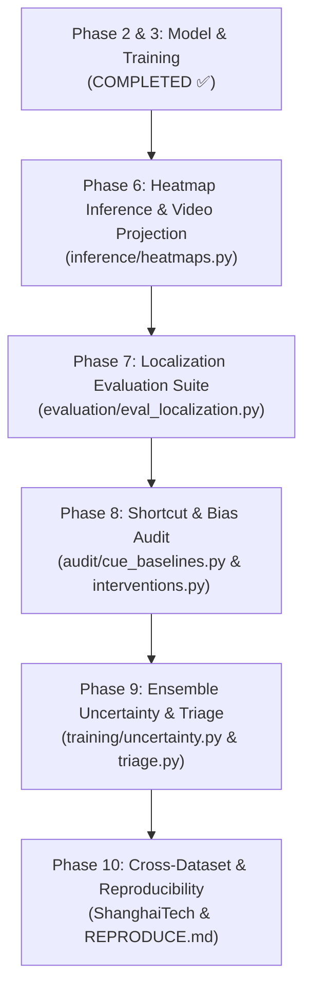

# Further Implementation Roadmap: Phases 6 through 10

This document outlines the remaining implementation phases (Phases 6–10) for the research track on **Dense Weakly Supervised Anomaly Localization with Compact From-Scratch 3D CNNs**.

For each phase, this document defines:
1. **Target Deliverables & File Structure**
2. **Detailed Architectural & Algorithmic Specifications**
3. **Step-by-Step Implementation Instructions**
4. **Validation Criteria & Smoke Tests**

---

## Roadmap Overview

| Phase | Title | Role in Paper | Key Modules |
|---|---|---|---|
| **Phase 6** | Heatmap Inference & Projection | Video-level inference & visualization | `inference/heatmaps.py` |
| **Phase 7** | Localization Evaluation Suite | Contribution A (Main localization result) | `evaluation/eval_localization.py`, `evaluation/annotations.py`, `benchmarks/efficiency.py` |
| **Phase 8** | Localization-Aware Shortcut Audit | Contribution B (Scientific validity & bias check) | `audit/cue_baselines.py`, `audit/interventions.py`, `audit/source_confound.py` |
| **Phase 9** | Ensemble Uncertainty & Triage | Contribution D (Practical deployment & risk control) | `training/uncertainty.py`, `inference/triage.py` |
| **Phase 10** | Cross-Dataset Check & Reproducibility | Generalization check & open release | `evaluation/eval_shanghaitech.py`, `REPRODUCE.md` |

---

## Phase 6: Heatmap Inference & Spatiotemporal Projection

### 1. Objective
Transform dense voxel predictions from overlapping 16-frame clips into a continuous, frame-by-frame 2D/3D heatmap representation across arbitrary-length surveillance videos.

### 2. Files to Create / Modify
- `inference/heatmaps.py`: Core inference, temporal aggregation, and rendering module.
- `scripts/predict_heatmaps.py`: CLI driver to batch process videos and output `.npz` files and video overlays.
- `tests/test_heatmap_pipeline.py`: Unit tests for overlap averaging and output dimension alignment.

### 3. Implementation Details

#### A. Sliding Window Overlap & Accumulation
- Input video is decoded at $10\text{ FPS}$ with target inference resolution (e.g., $112 \times 144$).
- Clips of length $T = 16$ frames are extracted with stride $S_{\text{stride}} = 8$ frames.
- For each clip $i$ spanning frame indices $[t_{\text{start}}, t_{\text{end}}]$:
  1. Forward pass through `DenseC3D` yields voxel logit tensor of shape $[1, T'=4, H', W']$.
  2. Apply sigmoid activation to obtain probabilities: $P_i \in [0, 1]^{4 \times H' \times W'}$.
  3. Spatially upsample each temporal slice bilinearly from $(H', W')$ to original video resolution $(H_{\text{orig}}, W_{\text{orig}})$.
  4. Temporally map the $4$ voxel slices onto the $16$ frame span by repeating each slice across $4$ consecutive frames.
  5. Accumulate predicted probabilities into global accumulator buffer $A \in \mathbb{R}^{T_{\text{video}} \times H_{\text{orig}} \times W_{\text{orig}}}$ and increment coverage counter buffer $C \in \mathbb{N}^{T_{\text{video}}}$.

#### B. Normalization & Temporal EMA
- Divide accumulated maps by coverage counter: $M_{\text{raw}} = A / \max(C, 1)$.
- Apply pixel-wise Exponential Moving Average (EMA) across time:
  $$M_t = \alpha \cdot M_{\text{raw}, t} + (1 - \alpha) \cdot M_{t-1}, \quad \text{with } \alpha = 0.3$$

#### C. Output Storage & Video Rendering
- Save compressed array as `{video_name}_heat.npz` in `float16` to conserve disk space.
- Render MP4 overlay:
  - Normalize heatmap to $[0, 255]$ with OpenCV `COLORMAP_JET` or `COLORMAP_TURBO`.
  - Alpha blend with original RGB frame: $I_{\text{vis}} = 0.6 \cdot I_{\text{rgb}} + 0.4 \cdot I_{\text{heatmap}}$.
  - Add timeline score graph and timestamp overlays.

---

## Phase 7: Dense Localization Evaluation Suite (Contribution A)

### 1. Objective
Quantify spatial and temporal localization performance without tuning decision thresholds on the test set.

### 2. Files to Create
- `evaluation/annotations.py`: Ingestion parser for UCF-Crime bounding boxes and SAM-2 verified pixel masks.
- `evaluation/metrics_localization.py`: Threshold-free and threshold-based localization metrics.
- `scripts/evaluate_localization.py`: Evaluation driver across all test videos.
- `benchmarks/efficiency.py`: FLOPs, parameter count, and inference throughput benchmark.

### 3. Implementation Details

#### A. Ground Truth Handlers
- **Bounding Boxes:** Parse public UCF-Crime box annotations (Liu & Ma 2019 / WSSTAD). Format: `[video_id, frame_idx, x1, y1, x2, y2]`.
- **Mini Pixel-Mask Dataset:** Curate 60–100 anomalous test videos (~10 annotated frames per video). Store binary masks in compressed NPZ/RLE format.

#### B. Threshold-Free Metrics (Primary)
1. **Pointing Game Hit Rate:**
   $$\text{Hit} = \mathbb{I}\left( \operatorname*{argmax}_{(h, w)} M_t(h, w) \in \text{Region}_{\text{GT}} \right)$$
   Compute fraction of annotated anomalous frames where the peak activation falls inside the ground-truth region. Compare against center-prior and random-prior baselines.
2. **Energy-in-Region:**
   $$\text{EnergyFraction} = \frac{\sum_{(h, w) \in \text{Region}_{\text{GT}}} M_t(h, w)}{\sum_{(h, w)} M_t(h, w)}$$
   Compare against the ground-truth region's area fraction:
   $$\text{AreaFraction} = \frac{\text{Area}(\text{Region}_{\text{GT}})}{H \times W}$$
3. **Pixel-Level ROC-AUC:**
   Compute ROC-AUC of all spatial pixel values against the binary ground-truth mask across annotated anomalous frames.

#### C. Threshold-Based Metrics (Secondary)
- Binarize heatmap at $0.5 \times \max(M_t)$.
- Extract connected components to form bounding boxes.
- Compute Spatiotemporal Intersection over Union (TIoU) and Relative/Total Bounding-box Detection Rates (RBDR / TBDR) at $\alpha = \beta = 0.1$.

#### D. Efficiency Benchmark (`benchmarks/efficiency.py`)
- Profile parameter counts and FLOPs using `fvcore.nn.FlopCountAnalysis`.
- Benchmark GPU clips/s throughput.
- Export ONNX graph and benchmark CPU throughput using `onnxruntime`.
- Plot: *Pointing Game Accuracy vs. GFLOPs* for `g7`, `g14`, and `g28`.

---

## Phase 8: Localization-Aware Shortcut Audit (Contribution B)

### 1. Objective
Demonstrate scientifically whether model predictions stem from real anomaly actions or spurious background, camera, and video-quality artifacts.

### 2. Files to Create
- `audit/cue_baselines.py`: Feature extractor for non-event cues and cue-only classifiers.
- `audit/source_confound.py`: Camera source confound analysis.
- `audit/interventions.py`: Region deletion, insertion, and control interventions.
- `audit/mitigation.py`: Quality-matched data augmentation and background suppression.

### 3. Implementation Details

#### A. 8.1 Cue-Only Classifiers
Extract non-event video statistics per clip:
1. Low-level video cues: Mean brightness, contrast (std dev), blur/sharpness (Laplacian variance), native resolution, FPS, bitrate (file size / duration), and frame-differencing motion magnitude.
2. Global scene context: Extract middle frame embeddings using frozen DINOv2 / CLIP, reduced to 16–32 dimensions via PCA.
3. Train Logistic Regression and Gradient Boosted Trees exclusively on these features using the training split. Evaluate frame-level AUC on the test set.

#### B. 8.2 Source Confound Control
Calculate and report frame-level ROC-AUC under three protocols:
1. **Standard AUC:** All test videos (normal + anomalous).
2. **Anomalous-Videos-Only AUC:** Frame-level AUC evaluated strictly within anomalous test videos (distinguishing anomaly frames from normal frames recorded by the *same* camera).
3. **Per-Category AUC:** Granular breakdown across the 13 UCF-Crime anomaly types.

#### C. 8.4 Region Interventions
Using test ground-truth boxes/masks, perform physical interventions on video clips:
- **Deletion:** Inpaint or replace the GT anomaly bounding box with Gaussian blur or mean frame color. Measure the score drop:
  $$\Delta_{\text{del}} = S(\text{Original}) - S(\text{Deleted})$$
- **Insertion (Background-Only):** Blank out everything *except* the GT anomaly box. Measure retained score.
- **Control Intervention:** Perform the exact same deletion/insertion on an equal-area non-anomalous background patch.
- **Criteria:** A valid model exhibits $\Delta_{\text{del}} \gg \Delta_{\text{control}}$. A shortcut-reliant model exhibits $\Delta_{\text{del}} \approx \Delta_{\text{control}}$.

#### D. 8.5 Background Reliance Score
Compute metric:
$$\text{BRS} = \operatorname{clip}\left(1 - \frac{\text{EnergyFraction}}{\text{AreaFraction}}, 0, 1\right)$$

#### E. 8.6 Shortcut Mitigation
Implement and ablate one mitigation mechanism:
- **Quality-Matched Augmentations:** Apply random brightness, contrast, Gaussian blur, and JPEG compression jitter equally to both normal and anomalous bags during training.
- **Motion-Based Suppression:** Penalize high anomaly logits in zero-motion regions via an optical-flow or frame-differencing mask loss.

---

## Phase 9: Ensemble Uncertainty & Alert Triage (Contribution D)

### 1. Objective
Quantify epistemic vs. aleatoric uncertainty from multi-seed ensembles and provide a rule-based triage system for security operators.

### 2. Files to Create
- `training/uncertainty.py`: Ensemble aggregation and information-theoretic uncertainty metrics.
- `inference/triage.py`: Rule-based alert tiering and structured payload generation.
- `scripts/evaluate_uncertainty.py`: Risk-coverage and calibration curves generator.

### 3. Implementation Details

#### A. Information-Theoretic Uncertainty Decomposition
Train an ensemble of $M = 5$ seeds (`seeds 0 1 2 3 4`) using the best configuration.
For each voxel $(t, h, w)$, gather predicted probabilities $\{p_m\}_{m=1}^M$:
1. Mean ensemble prediction:
   $$\bar{p} = \frac{1}{M}\sum_{m=1}^M p_m$$
2. Predictive entropy (total uncertainty):
   $$H(\bar{p}) = -\bar{p}\log_2(\bar{p}) - (1-\bar{p})\log_2(1-\bar{p})$$
3. Aleatoric uncertainty (mean entropy):
   $$H_{\text{aleatoric}} = \frac{1}{M}\sum_{m=1}^M H(p_m)$$
4. Mutual Information (epistemic uncertainty):
   $$\text{MI} = H(\bar{p}) - H_{\text{aleatoric}}$$

#### B. Risk-Coverage Curves
- Sort predicted anomalous events in ascending order of uncertainty $\text{MI}$.
- Iteratively withhold the most uncertain predictions (reducing coverage from $100\%$ down to $20\%$).
- Plot: *Precision and Hit-Rate vs. Coverage*. Valid uncertainty quantification yields strictly increasing precision as coverage drops.

#### C. Rule-Based Triage Module (`inference/triage.py`)
Format alerts into actionable operator payloads:
```python
{
    "video_id": "Burglary021_x264",
    "interval": [134.5, 151.0],
    "duration_sec": 16.5,
    "peak_score": 0.88,
    "epistemic_uncertainty": 0.042,
    "confidence_tier": "HIGH",     # Based on MI < validation median
    "severity_tier": "CRITICAL"    # Based on peak_score > 0.8 and duration > 5s
}
```

---

## Phase 10: Cross-Dataset Check & Reproducibility

### 1. Objective
Verify cross-domain generalization and prepare open-source release artifacts.

### 2. Files to Create
- `evaluation/eval_shanghaitech.py`: Ingestion and zero-shot transfer evaluation on ShanghaiTech Campus.
- `REPRODUCE.md`: Complete replication guide with exact commands, checkpoint links, and expected metrics.

### 3. Implementation Details
- Evaluate frozen UCF-Crime checkpoint directly on the ShanghaiTech Campus test set.
- Report frame-level ROC-AUC and document domain shift degradation.
- Create automated test verification scripts ensuring all pre-trained weights and pipelines run out of the box.

---

## Recommended Execution Order


